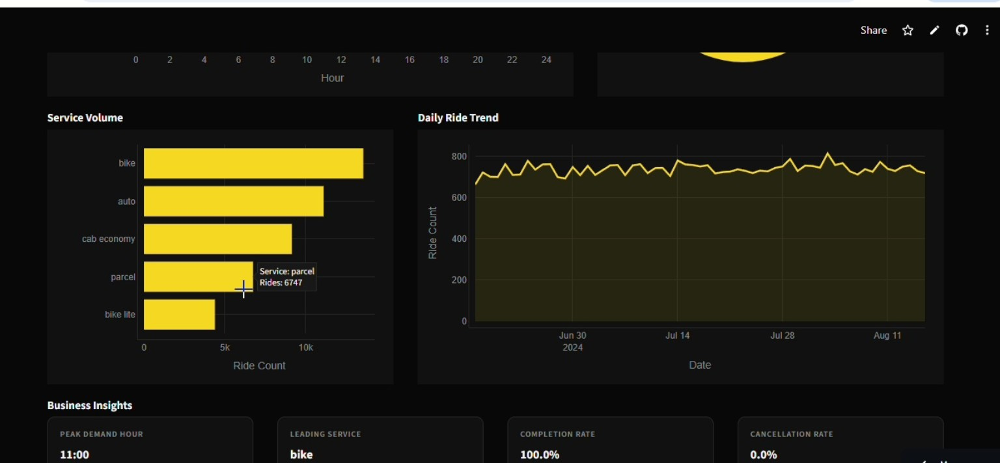
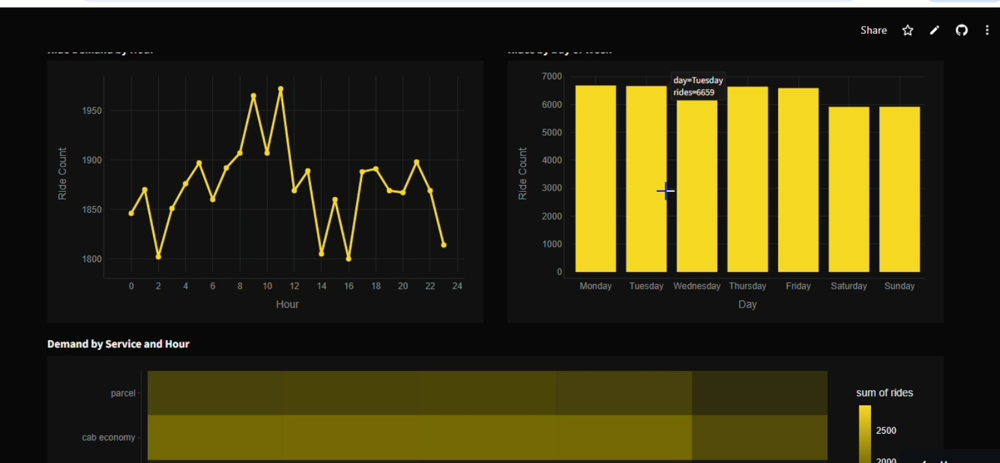

# 🚖 Rapido Ride Intelligence

**End-to-end ride-hailing analytics: an interactive dashboard, revenue-leakage quantification, statistical testing, SQL analysis, and a data-validity audit on 50,000 trips.**

`Python` `SQL` `Pandas` `NumPy` `SciPy` `Plotly` `Streamlit`

🔗 **[Live Dashboard](https://rapido-ride-intelligence-po3rarnj2dd66w4pzlt94e.streamlit.app/)**








---

## 📌 1. Business Problem

A ride-hailing operator earns revenue only when a booked ride is completed. Every cancelled ride is lost revenue, wasted driver time, and a worse rider experience. Leadership needs to know:

1. How much revenue is cancellation costing us?
2. Is cancellation concentrated in a service, time slot or day we can target?
3. Is the data reliable enough to base pricing and demand decisions on?

## 🎯 2. Project Objectives

- Analyse ride demand patterns by hour, day and month
- Measure revenue from completed rides
- Evaluate completion and cancellation performance
- Compare service-level performance
- Analyse payment-method contribution
- Understand trip duration and distance patterns
- Identify high-demand pickup, destination and route patterns
- Quantify revenue lost to cancellations
- Test whether the data is reliable
- Deliver everything as an interactive business-intelligence tool

## 🧩 3. Solution Overview

| Layer | What I built | Business purpose |
|-------|--------------|------------------|
| KPI layer | Revenue, completion rate, average fare, cancellations, with filters | One source of truth for performance |
| Leakage model | Cancelled rides × average completed fare | Puts a rupee value on the problem |
| Driver analysis | Chi-square tests across service, hour, weekday | Separates real patterns from noise |
| Validity audit | Fare-distance correlation, speed checks, route uniqueness | Tests whether insights can be trusted |
| SQL layer | Six queries reproducing the KPIs and audits | Cross-checks Python results |
| Dashboard | 6-page Streamlit app with global filters | Self-serve exploration for stakeholders |

## 🔎 4. Key Findings

| # | Finding | Evidence |
|---|---------|----------|
| 1 | **Cancellations leak an estimated ₹2.76M, about 10% of potential revenue.** | 5,036 cancelled rides × ₹547 avg fare. Completed revenue: ₹24.6M from 44,964 rides. |
| 2 | **Cancellation is uniform: ~10% across every service, hour and weekday.** | Chi-square p-values: service 0.31, hour 0.80, weekday 0.72 (all > 0.05). |
| 3 | **Fare does not depend on distance.** | corr(distance, fare) = −0.005. Avg fare is ₹544-549 in every distance band. |
| 4 | **~10% of completed trips are physically implausible.** | 4,415 rides imply >80 km/h (max 300 km/h). corr(distance, duration) = 0.008. |
| 5 | **Demand is flat once partial months are normalised.** | Rides per day: Jun 806, Jul 824, Aug 823. |
| 6 | **Route-level analysis carries no signal.** | 49,993 unique routes in 50,000 rides; only 7 repeat. |

Other headline numbers: 50,000 rides, 17 Jun to 16 Aug 2024, 89.9% completion rate, ₹547 average fare, five services (bike, auto, cab economy, parcel, bike lite).

## 💡 5. Decisions This Supports

- **Prioritise cancellation reduction.** Every 1 percentage point cut recovers about ₹274K over this 61-day window (500 rides × ₹547), roughly ₹1.6M annualised at constant volume (sensitivity estimate, not a forecast).
- **Run platform-wide interventions, not segment-specific ones.** No service, hour or weekday is meaningfully worse.
- **Fix data before pricing or demand modelling.** Fares unrelated to distance means any pricing or peak-hour model on this data would be unreliable.
- **Instrument cancellations.** Capture who cancelled and why; the current data cannot explain the 10%.

## 📊 6. Dashboard Pages

**Overview**: executive KPIs (total rides, total revenue, completion rate, cancellations, average fare), ride demand by hour, ride outcome mix, service volume, daily ride trend, and business-insight cards.

**Demand**: hourly demand, rides by day of week, demand by service and hour, monthly volume, daily trends. Shows peak hours, high-demand days and low-activity periods.

**Revenue**: daily revenue trend, revenue by payment method, average fare by service, fare distribution. All based on completed rides.

**Operations**: ride status by service, completion rate by service, cancellation rate by hour, trip duration distribution.

**Locations**: top pickup locations, top destinations, and popular routes (Source → Destination). No external map data required.

**Data Quality**: fare-vs-distance correlation, share of impossible speeds (>80 km/h), missing-fare count, repeated routes, a fare-vs-distance scatter plot, and average fare by distance band.

**Ride Explorer**: filtered ride-level table (up to 100 records) with service, status, payment method, pickup, destination, fare and trip details.

## 🎛️ 7. Interactive Filters

| Filter | Description |
|--------|-------------|
| Service | Filter by service type |
| Ride Status | Completed, cancelled and other outcomes |
| Payment Method | Filter by payment type |
| Analysis Period | Select a date range |

Filters update the KPI cards, charts, insights, Ride Explorer and every page. The app safely handles filters that return no records.

## 🗂️ 8. Dataset

`rides_data.csv`: 50,000 rides, 17 Jun to 16 Aug 2024.

Columns: `services`, `date`, `time`, `ride_status`, `source`, `destination`, `duration`, `ride_id`, `distance`, `ride_charge`, `misc_charge`, `total_fare`, `payment_method`.

## 🧹 9. Data Processing

| Column | Transformation |
|--------|----------------|
| date | Converted to datetime |
| time | Parsed into hour |
| duration, distance | Converted to numeric |
| ride_charge, misc_charge, total_fare | Converted to numeric |

The app safely handles missing values, invalid numbers, invalid dates, missing cancelled-ride fares and empty filter results.

**Data validation:** checked duplicates (none), nulls, speed outliers and fare-per-km extremes.

## 💰 10. Revenue Methodology

- Revenue and average fare use **completed rides only**.
- 5,036 cancelled rides have no fare or payment method. They are excluded from revenue but kept for demand, cancellation, operations and ride-status analysis.
- Missing fares are never treated as ₹0.

| Metric | Definition |
|--------|------------|
| Revenue | Sum of `total_fare` for completed rides |
| Completion rate | Completed ÷ total rides |
| Revenue leakage | Cancelled rides × average completed fare |
| Implied speed | `distance ÷ (duration ÷ 60)` in km/h |

## 🧪 11. Statistical Approach

- Chi-square test of independence for cancellation vs service, hour and weekday (α = 0.05).
- Pearson correlation for pricing and duration logic.
- Months normalised by active days, since June and August are partial.
- Assumption: the average completed fare is a fair proxy for what a cancelled ride would have earned.

## 🗃️ 12. SQL Analysis

`sql/queries.sql` contains six queries, run with `python sql/run_sql.py`:
1. Headline KPIs
2. Estimated revenue lost to cancellations
3. Cancellation rate by service
4. Fare vs distance band
5. Impossible trips (speed above 80 km/h)
6. Rides per day by month

## 🛠️ 13. Tech Stack

| Tool | Purpose |
|------|---------|
| Python | Core language |
| Streamlit | Interactive dashboard |
| Pandas, NumPy | Data manipulation |
| SciPy | Statistical tests |
| Plotly | Interactive charts |
| SQL (SQLite) | Query-based analysis |

## 🎨 14. Dashboard Design

Dark theme with Rapido-inspired yellow accent, KPI cards, responsive column layouts, and real Streamlit navigation (no static HTML nav).

## 📁 15. Project Structure

```
rapido_ride_intelligence.py    Streamlit dashboard (6 pages, global filters)
analysis/findings.py           Reproduces every number in this README
sql/queries.sql, run_sql.py    SQL KPIs and audits
rides_data.csv                 Ride-level dataset
requirements.txt               Dependencies
README.md                      Documentation
```

## 🚀 16. Run It

Requires Python 3.9+.

```bash
pip install -r requirements.txt
python -m streamlit run rapido_ride_intelligence.py   # dashboard
python analysis/findings.py                           # findings and tests
python sql/run_sql.py                                 # SQL queries
```

Dashboard opens at `http://localhost:8501`.

## ☁️ 17. Deployment

Deployed on Streamlit Community Cloud, so it runs in the browser with no installation. It redeploys automatically when the GitHub repo is updated.

## 🏢 18. Business Use Cases

- **Demand planning:** peak hours, high-demand days, monthly patterns, service-level demand
- **Revenue management:** revenue trends, average fare, payment-method contribution
- **Operational performance:** completion and cancellation rates, trip duration
- **Location intelligence:** high-volume pickups, popular destinations, frequent routes

## 🔐 19. Data Privacy

Dataset contains no personal information. Before publishing any ride data, remove identifiers and prefer anonymised or sample data.

## ⚠️ 20. Limitations

- Two-month window; no seasonality or trend can be assessed.
- No cancellation reason, canceller, driver or city fields.
- Data-validity issues (findings 3 and 4) suggest synthetic data or a pricing-pipeline fault, so findings 2-6 should be re-run on production data.

## 🔮 21. Next Steps

- Re-run the full analysis on verified production data.
- Add cancellation-reason and driver-side fields, then model cancellation probability (logistic regression).
- Forecast daily rides and revenue once longer history is available.
- Add geographic map visualisations and downloadable reports.
